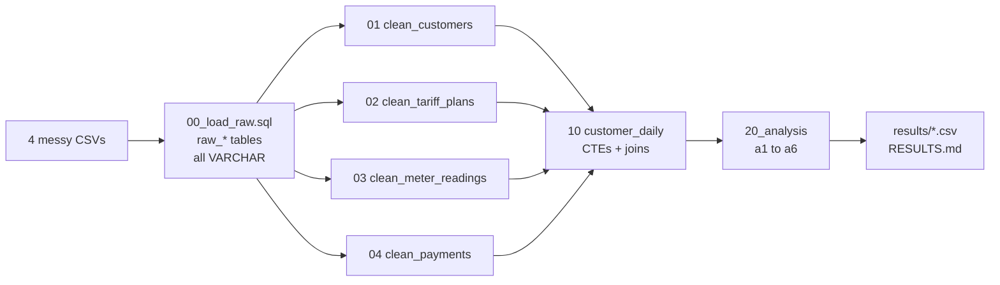

# Mini-Grid SQL Analytics

All the cleaning and analysis for a solar mini-grid operator's messy data, done **in SQL** with DuckDB: raw text in, clean views, a combined customer-day view, and six business questions answered.

This is the SQL companion to [minigrid-data-pipeline](https://github.com/QuinnDavids/minigrid-data-pipeline), which solves the same problem in Python. Same scenario, same data, same answers: both produce the same 31,402 customer-day rows.

## The problem

A solar mini-grid operator in Nigeria keeps customer data in four files, each kept by a different team: `customers.csv`, `tariff_plans.csv`, `meter_readings.csv` and `payments.csv`. Each team types things its own way (`"800 Wh"` and `"1.2kwh"`, `"₦5,000"` and `"NGN 5000"`, `05/03/2026` and `5 Mar 2026`), and there are duplicate rows, impossible values and payments from unknown customers. The operator wants clean data and answers to six questions about energy use, revenue and customers at risk.

## Data flow



## SQL techniques and where to find them

| Technique | File |
|---|---|
| `TRIM`, `UPPER` / `LOWER` | [`00_load_raw.sql`](sql/00_load_raw.sql) (`clean_text`, `clean_id` macros), [`01_clean_customers.sql`](sql/01_clean_customers.sql) |
| `NULLIF(TRIM(x), '')` to turn blanks into NULL | [`00_load_raw.sql`](sql/00_load_raw.sql) (`clean_text`) |
| Missing-token check `LOWER(TRIM(x)) IN ('n/a', 'none', '-', 'null')` | [`00_load_raw.sql`](sql/00_load_raw.sql) (`clean_text`) |
| `COALESCE` with business defaults (`'Unknown'`, `0`, `'No payment'`) | [`01_clean_customers.sql`](sql/01_clean_customers.sql), [`10_daily_customer.sql`](sql/10_daily_customer.sql) |
| Filling missing values with a window function (`AVG(...) OVER (PARTITION BY community)`) | [`01_clean_customers.sql`](sql/01_clean_customers.sql) |
| `REGEXP_EXTRACT` for numbers inside text | [`03_clean_meter_readings.sql`](sql/03_clean_meter_readings.sql), [`01_clean_customers.sql`](sql/01_clean_customers.sql), `parse_naira` in [`00_load_raw.sql`](sql/00_load_raw.sql) |
| `CASE` for unit conversion (Wh → kWh) and naira formats | [`03_clean_meter_readings.sql`](sql/03_clean_meter_readings.sql), [`04_clean_payments.sql`](sql/04_clean_payments.sql) |
| `TRY_CAST` / `TRY_STRPTIME` for safe parsing; day-first slash dates | `parse_date` in [`00_load_raw.sql`](sql/00_load_raw.sql), [`03_clean_meter_readings.sql`](sql/03_clean_meter_readings.sql) |
| `CASE` for strict booleans (unknown → NULL) | [`04_clean_payments.sql`](sql/04_clean_payments.sql) |
| `ROW_NUMBER() OVER (PARTITION BY … ORDER BY …)` for de-duplication | [`01`](sql/01_clean_customers.sql), [`02`](sql/02_clean_tariff_plans.sql), [`03`](sql/03_clean_meter_readings.sql), [`04`](sql/04_clean_payments.sql) |
| Filling a missing value from another table with a business rule | [`10_daily_customer.sql`](sql/10_daily_customer.sql) (customers with no plan get the Basic plan, looked up in `clean_tariff_plans`) |
| CTEs (`WITH`) | every view and most analysis queries |
| `FULL OUTER JOIN`, `INNER JOIN`, `LEFT JOIN` | [`10_daily_customer.sql`](sql/10_daily_customer.sql) |
| `GROUP BY` aggregation, `DATE_TRUNC` | [`a1`](sql/20_analysis/a1_monthly_energy_by_community.sql), [`a2`](sql/20_analysis/a2_revenue_vs_consumption.sql) |
| `RANK()` | [`a3`](sql/20_analysis/a3_top_customers_rank.sql) |
| Window frame `RANGE BETWEEN INTERVAL '6 days' PRECEDING AND CURRENT ROW` | [`a4`](sql/20_analysis/a4_rolling_7day_usage.sql) |
| `CROSS JOIN`, date arithmetic | [`a5`](sql/20_analysis/a5_customers_at_risk.sql) |
| `COUNT(DISTINCT …)` | [`a6`](sql/20_analysis/a6_users_per_plan.sql) |

The SQL is written to run on PostgreSQL wherever practical. DuckDB-only pieces (`CREATE MACRO`, `read_csv`, `TRY_STRPTIME`, `SELECT * EXCLUDE`) are marked with a comment and the PostgreSQL alternative.

## Results

Full answers in [`results/RESULTS.md`](results/RESULTS.md). Highlights:

- **a2, revenue vs consumption:** every plan collects 108% to 117% of the metered cost of energy each month. Collections run above 100% because prepaid customers also pay for days when the meter did not report a reading.
- **a3, top consumers:** all top 10 are Productive Use customers with households of 6 or more, led by MG-0188 in Isiokpo (1,293 kWh over four months).
- **a5, customers at risk:** 3 customers used energy in the last 14 days of data without a counted payment; the largest is MG-0280 (Buguma, Productive Use), ₦32,636 of energy and 16 days since their last payment.
- **a6, customers per plan:** Basic 125, Standard 86, Productive Use 46, Business 43. Four Basic customers had no plan on file and were assigned Basic by the business rule.

## How to run it

Needs Python 3.11 or newer. From the project folder, in VS Code's terminal:

```bash
python -m venv .venv
.venv\Scripts\activate          # Windows
source .venv/bin/activate       # macOS / Linux

pip install -r requirements.txt
python scripts/generate_data.py
python run.py
pytest
```

`run.py` builds `data/minigrid.duckdb`, runs every `.sql` file in order, logs each object's row count, and writes `results/<question>.csv` and `results/RESULTS.md`. To explore the data yourself, open `data/minigrid.duckdb` with the DuckDB CLI or any DuckDB-aware tool and query the views.

## Project structure

```
minigrid-sql-analytics/
├── scripts/generate_data.py   copied unchanged from minigrid-data-pipeline
├── sql/
│   ├── 00_load_raw.sql        raw_* tables + shared macros
│   ├── 01-04_clean_*.sql      one cleaning view per source
│   ├── 10_daily_customer.sql  combined view
│   └── 20_analysis/a1-a6      the six questions
├── run.py                     runs the SQL, exports results
├── tests/test_views.py        30 checks on the views and results
└── results/                   CSV answers + RESULTS.md
```

## Tests

`pytest` generates fresh data into a temporary folder, builds everything and checks: customer IDs unique and never null, no missing-value tokens left, energy never negative, outage hours within 0–24, amounts numeric and positive, the reversed flag only TRUE / FALSE / NULL, `(customer_id, date)` unique in `customer_daily`, and every analysis query returning rows.

## Credits

The data generator comes from [minigrid-data-pipeline](https://github.com/QuinnDavids/minigrid-data-pipeline), Project 1 of this pair, and is used unchanged (same seed, same messy files).

## Disclosure

> This project re-implements the SQL techniques I used in the DataCamp Data Engineer Associate certification practical exam. Because certification tasks may be reused, the scenario, dataset and queries here are new: the data is synthetic and generated by `scripts/generate_data.py`. The underlying principles are the same.

Names, communities, phone numbers and tariff prices are illustrative; email addresses use the reserved `example.com` domain.

## Tools used

DuckDB, SQL, Python, pandas, pytest.
